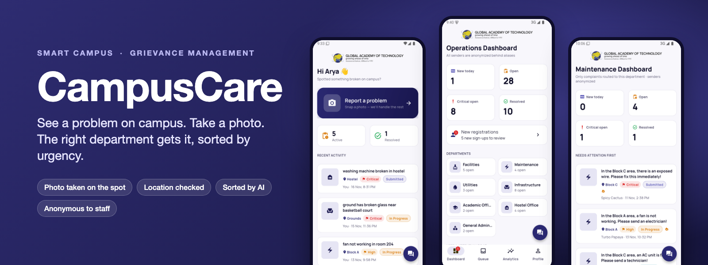
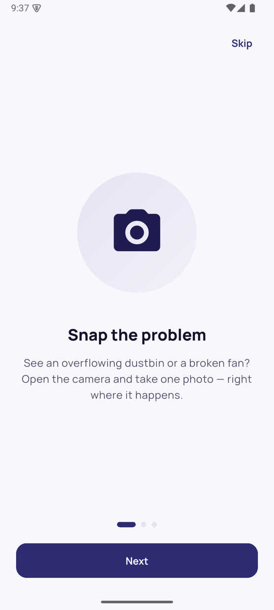
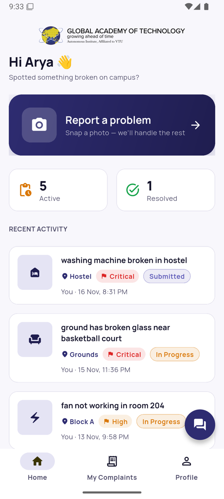
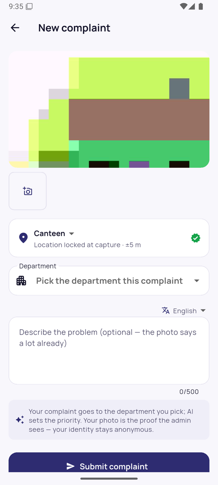
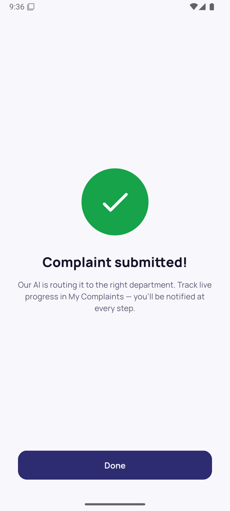
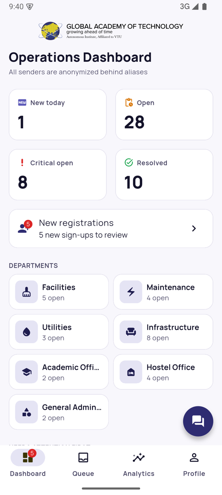
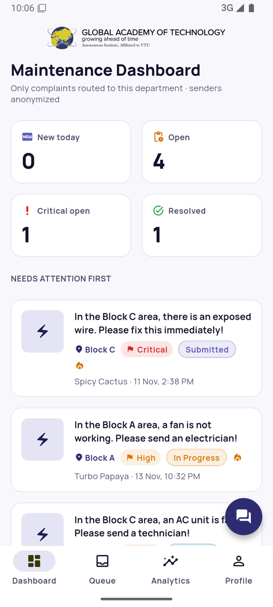
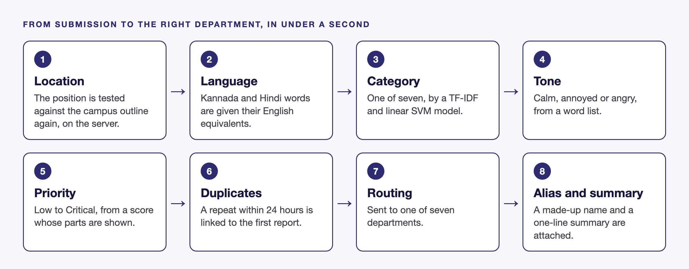
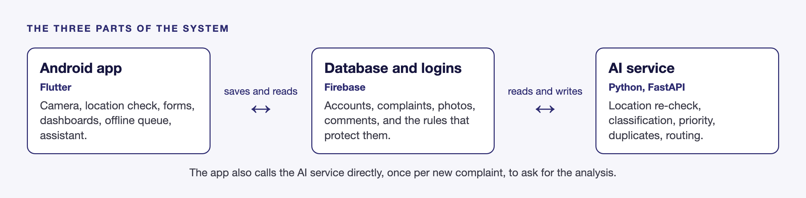

<p align="center">
  
</p>

<h1 align="center">CampusCare</h1>

<p align="center">
  <b>AI-Based Student Grievance Management System for Smart Campus</b><br>
  B.E. major project · Department of Information Science and Engineering · Global Academy of Technology, Bengaluru
</p>

<p align="center">
  
  
  
  
  <br>
  
  
  
  
</p>

<p align="center">
  <a href="#the-app">The app</a> ·
  <a href="#why-it-was-built">Why</a> ·
  <a href="#what-it-does">Features</a> ·
  <a href="#what-happens-to-a-complaint">Pipeline</a> ·
  <a href="#how-it-is-built">Architecture</a> ·
  <a href="#results">Results</a> ·
  <a href="#run-it-on-your-computer">Run it</a> ·
  <a href="#the-guides">Guides</a>
</p>

---

CampusCare is a complaint system for a college campus. A student who sees a
broken fan, a leaking tap or an overflowing bin opens the app, takes a
photograph on the spot and submits it. The system checks that the photo was
taken inside the campus, works out what kind of problem it is and how urgent,
and sends it to the department responsible. The department sees the complaint
under a made-up name, deals with it, and the student watches the status
change.

## The app

**For students**

<table>
  <tr>
    <td align="center" width="25%"></td>
    <td align="center" width="25%"></td>
    <td align="center" width="25%"></td>
    <td align="center" width="25%"></td>
  </tr>
  <tr>
    <td align="center" valign="top"><b>First screen</b><br><sub>A three-step introduction to reporting.</sub></td>
    <td align="center" valign="top"><b>Home</b><br><sub>One button starts a report. Recent complaints show their status.</sub></td>
    <td align="center" valign="top"><b>New complaint</b><br><sub>The zone is locked from GPS when the photo is taken. The emulator's camera shows a test picture.</sub></td>
    <td align="center" valign="top"><b>Submitted</b><br><sub>The analysis happens in the next few seconds.</sub></td>
  </tr>
</table>

**For staff**

<table>
  <tr>
    <td align="center" width="25%"></td>
    <td align="center" width="25%"></td>
    <td valign="top" width="50%">
      <br>
      <b>College admin</b><br>
      Sees all seven departments, the counts for the whole college and the list of new sign-ups.<br><br>
      <b>Department admin</b><br>
      Sees only the complaints routed to that department, each with a one-line summary written by the system and the sender shown as an alias.<br><br>
      <b>Both</b><br>
      A queue with search and filters, a detail page with the photos and a campus map, buttons to assign, start, resolve or reject, and analytics with a CSV export.
    </td>
  </tr>
</table>

## Why it was built

On most campuses a maintenance complaint is made by telling someone, or by
writing in a register. Four things go wrong with that, and each one is
answered by a design decision.

| Problem | What goes wrong | What CampusCare does |
|---|---|---|
| **No record** | Nobody can later show that the complaint was made, or when. | Every complaint is stored with its time, place and photo, and a timeline of what happened to it. |
| **No sorting** | An exposed wire waits in the same pile as a broken chair. | Each complaint gets a category and a priority within a second, so the urgent ones rise. |
| **No trust** | The student's name travels with the complaint, so students hesitate. | Staff see an alias. The database itself refuses to show them the name. |
| **No proof of place** | Typed text cannot tell a real report from one written at home. | The photo is taken in the app, and the position is checked against the campus outline. |

## What it does

| | |
|---|---|
| **Photo on the spot** | The app opens its own camera. A picture cannot be picked from the gallery, so every report is taken at the place and time of the problem. |
| **Location check** | The phone's position is tested against the outline of the campus, once in the app and again on the server. A report from outside is refused. |
| **Automatic sorting** | Each complaint is classified into one of seven categories and given a priority from Low to Critical. The parts of the priority score are shown, so staff can see why. |
| **Routing** | The complaint goes to one of seven departments. A department admin sees only that department's complaints; the college admin sees all. |
| **Anonymity** | Staff see an alias such as "Captain Otter". The student's name is kept where admin accounts cannot read it, and the database rules enforce this, not the screens. |
| **Three languages** | English, Kannada and Hindi. Kannada and Hindi can be typed on an ordinary English keyboard. |
| **Offline** | A complaint made without a connection is kept on the phone and sent later, with its original time and place. |
| **Follow-up** | A timeline for each complaint, comments between student and department, a rating, and reopening after a poor fix. |
| **Duplicates and escalation** | Repeated reports of one problem are linked. A complaint untouched for three days is raised one level. |
| **Analytics** | Totals by category and zone, time to resolve, average rating, and an export to CSV. |
| **Assistant** | A chat window that answers questions about the college and the app from a fixed list. It uses no outside service and no key. |

## What happens to a complaint

When a complaint is submitted, the app sends its text and position to the AI
service. The service runs these steps and writes the result back to the
database, usually in under a second.

<p align="center">
  
</p>

| Step | What is done | How |
|---|---|---|
| 1. Location, again | The position is tested against the campus outline a second time, on the server. | A modified app cannot skip this check. The outline is a 63-point polygon traced from OpenStreetMap. |
| 2. Language | Kannada and Hindi words are given their English equivalents. | The classifier understands English only. The student's own words are stored unchanged. |
| 3. Category | Cleanliness, Electrical, Plumbing, Furniture, Academics, Hostel or Other. | A TF-IDF and linear support vector machine model. |
| 4. Tone | Calm, annoyed or angry. | A word list built for complaint text. |
| 5. Priority | Low, Medium, High or Critical. | A score added up from the category, urgent words such as "sparking", the tone and the zone. |
| 6. Duplicates | A repeat of an open complaint in the same zone within 24 hours is linked to the first, whose priority is raised. | Comparison against recent complaints in the database. |
| 7. Routing | The complaint is sent to one of seven departments. | The department the student picked decides; otherwise the category does. The model's own guess is kept beside it. |
| 8. Alias and summary | A made-up name and a one-line summary are attached. | A fresh alias for every complaint, so two complaints by one student cannot be connected. |

## How it is built

<p align="center">
  
</p>

| Part | Built with | Folder |
|---|---|---|
| Android app | Flutter (Dart) | [`code/mobile`](code/mobile) |
| Database and logins | Firebase Authentication, Cloud Firestore | [`code/firebase`](code/firebase) |
| AI service | Python, FastAPI, scikit-learn | [`code/ai-service`](code/ai-service) |
| One-command local run | Python standard library, shell, batch | [`code/launcher`](code/launcher), [`code/mac`](code/mac), [`code/windows`](code/windows) |

## Results

The classifier was trained on 904 labelled complaints, with 80 % used for
training and 20 % (181 complaints) held back for testing.

| Measure | Result |
|---|---|
| Accuracy on the unseen 181 | **96.1 %** (174 correct) |
| Macro F1 over seven categories | **0.963** |
| Automated tests | **112**, all passing (44 for the AI service, 68 for the app) |

| Category | Precision | Recall | F1 | Test complaints |
|---|---|---|---|---|
| Academics | 1.00 | 1.00 | 1.00 | 24 |
| Cleanliness | 0.93 | 0.96 | 0.94 | 26 |
| Electrical | 0.90 | 0.97 | 0.93 | 29 |
| Furniture | 0.96 | 0.96 | 0.96 | 25 |
| Hostel | 0.96 | 0.92 | 0.94 | 26 |
| Other | 1.00 | 0.96 | 0.98 | 24 |
| Plumbing | 1.00 | 0.96 | 0.98 | 27 |

These figures are written by the training script to
[`code/ai-service/MODEL_REPORT.md`](code/ai-service/MODEL_REPORT.md).

## Run it on your computer

One command. It downloads what it needs into the project folder, starts
everything on your own computer (localhost) and opens the app on an Android
phone emulator. No account, no key and no installation is needed.

Download this repository (the green **Code** button, then **Download ZIP**)
and unzip it, or clone it. Then:

**Mac** — open Terminal in the project folder and type:

```
bash code/mac/run.sh
```

**Windows** — open the folder `code\windows` and double-click `run.bat`,
or type this in Command Prompt opened in the project folder:

```
code\windows\run.bat
```

Those two lines need the window to be inside the project folder. With the
folder's location in front, the command works from anywhere. For a folder
named `Project_Grievance_Management_System_Global` kept in Downloads:

```
bash ~/Downloads/Project_Grievance_Management_System_Global/code/mac/run.sh
```

```
"%USERPROFILE%\Downloads\Project_Grievance_Management_System_Global\code\windows\run.bat"
```

When it prints **Local host is ready**, the app is open on the phone on your
screen.

| To see | Log in as | Password |
|---|---|---|
| The student side | `student@demo.com` | `password123` |
| The whole college as an admin | `admin@demo.com` | `password123` |
| One department only | `maintenance.admin@demo.com` | `password123` |

These are demo accounts that exist only in the local run. You need an
internet connection for the first run (about 3 GB is downloaded), 15 GB of
free disk space and 8 GB of RAM, on Windows 10 or 11 (64-bit) or macOS 12
and newer. Every step, and what to do if something goes wrong, is in
[How to Run](guidelines/02-how-to-run/How-to-Run.pdf).

## What is in this repository

```
.
├── code
│   ├── mobile        Android app (Flutter)
│   ├── ai-service    AI service, trained model, training scripts, tests
│   ├── firebase      Database rules, indexes, emulator configuration
│   ├── launcher      The local run, and the app built for it
│   ├── mac           run.sh
│   ├── windows       run.bat
│   └── keys          Where your own keys go (an empty template)
├── docs              Research paper, report, presentation, poster
└── guidelines        Ten guides, from a first run to going online
```

## The guides

| Guide | For |
|---|---|
| [Start Here](guidelines/00-START-HERE.pdf) | What to open first |
| [Project Overview](guidelines/01-overview/Project-Overview.pdf) | What the project does and how |
| [Code Overview](guidelines/01-overview/Code-Overview.pdf) | How the code is organised |
| [How to Run](guidelines/02-how-to-run/How-to-Run.pdf) | Running it, step by step, with troubleshooting |
| [Access Guide](guidelines/03-access/Access-Guide.pdf) | Every login and every address |
| [Keys and Environment](guidelines/04-keys/Keys-and-Environment.pdf) | The keys the project can use, and where yours go |
| [Firebase Setup](guidelines/05-firebase/Firebase-Setup-Guide.pdf) | Creating your own Firebase project |
| [Hosting and Deployment](guidelines/06-hosting/Hosting-and-Deployment-Guide.pdf) | Hosting the AI service; building the app for real phones |
| [Showcase Guide](guidelines/07-showcase/Showcase-Guide.pdf) | LinkedIn, X and resume |
| [Project Completion Notes](guidelines/08-completion/Project-Completion-Notes.pdf) | What was delivered and tested |

## The documents

| Document | File |
|---|---|
| Research paper (IEEE conference format) | [PDF](docs/research-paper/CampusCare_IEEE_Conference_Paper.pdf) |
| Project report | [PDF](docs/report/CampusCare_Project_Report.pdf) |
| Presentation | [PPTX](docs/ppt/CampusCare_Project_Presentation.pptx) |
| Poster | [PDF](docs/poster/CampusCare_Poster.pdf) |

## Taking it online

The local run is enough for a demonstration, a viva or studying the code.
For real phones and real users, the database and logins move to a Firebase
project that you create, and the AI service moves to a server. The guides
*Keys and Environment*, *Firebase Setup* and *Hosting and Deployment* go
through it step by step.

This repository contains no keys and is connected to no account. Anything
you connect it to is your own, and goes in `code/keys/`. Never commit the
service account file; `.gitignore` already keeps it out.

## Known limits

- Android only; there is no iPhone version.
- The 904 training complaints were written to resemble real ones. The model
  should be retrained as real complaints accumulate; a script is included.
- The campus outline is exact, but the eight zones inside it are estimates
  and should be checked on site.
- Status changes appear in the app while it is open. There are no push
  notifications to a closed phone.
